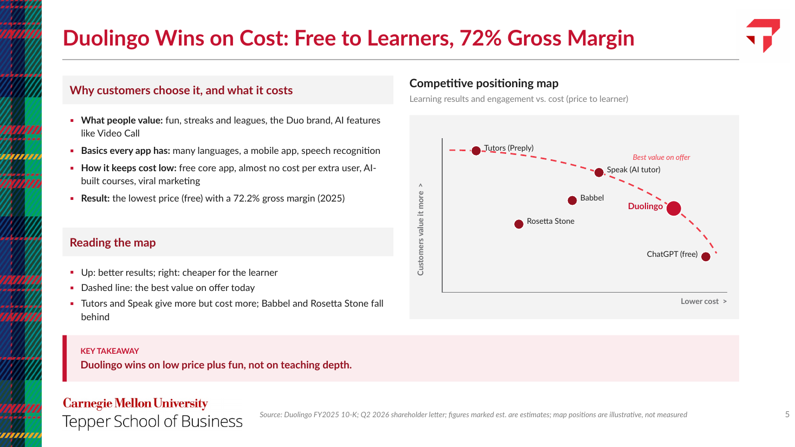
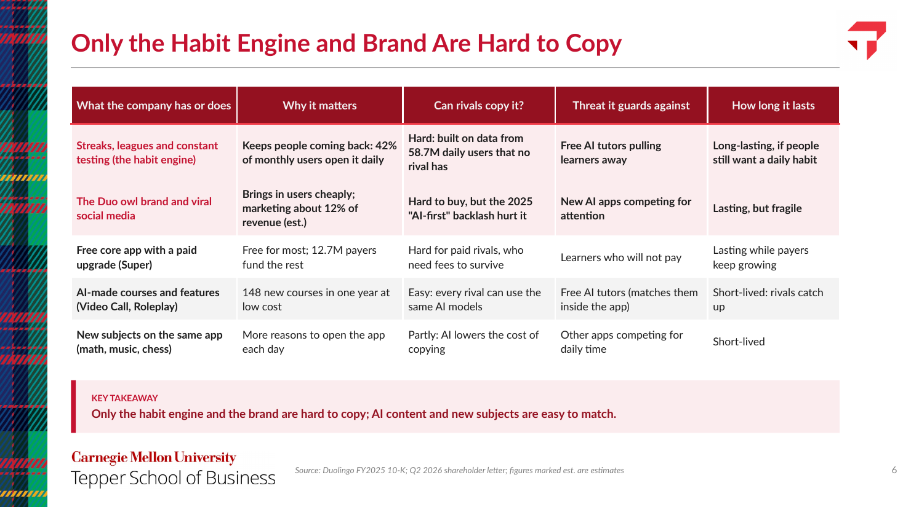
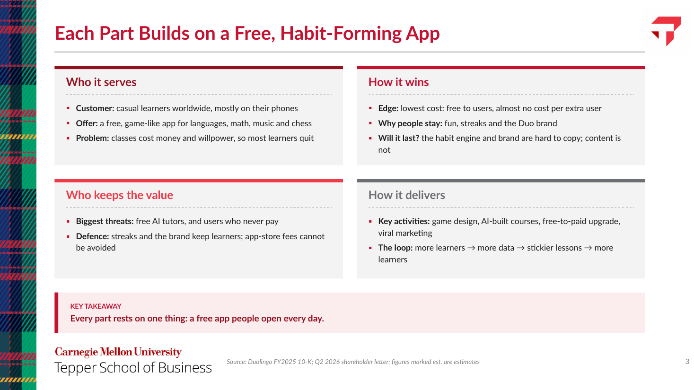
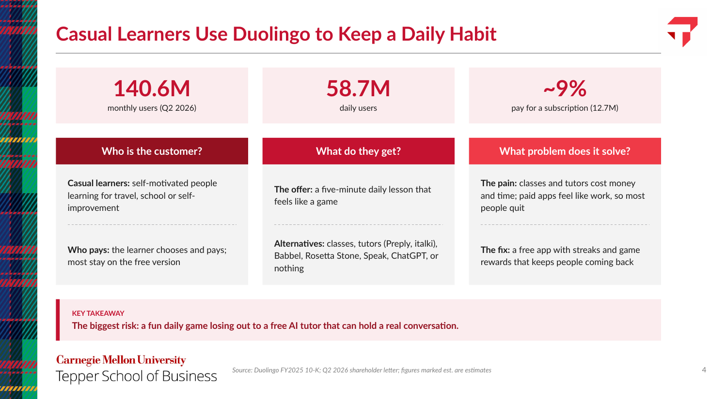

# AI Business Strategy Agent

A Claude Skill that turns one question, **"Give me [company]'s strategy"**, into a researched, consulting-style strategy deck.

The agent researches the company from public filings and news, then runs the **Define, Create, Capture, Deliver (DCCD)** framework in order, so each stage feeds the next. A Python pipeline renders the result as a 6-slide PowerPoint deck written for a general business reader. The agent also answers follow-up questions concisely and defends its conclusions when challenged.

Built at Carnegie Mellon's Tepper School of Business (MSBA), where it was tested live on an unseen company.


## What it produces

| # | Slide | What it answers |
|---|---|---|
| 1 | Title | |
| 2 | Strategy in four parts | Who it serves, how it wins, who keeps the value, how it delivers, plus the competitive advantage |
| 3 | How the parts connect | How each part builds on the next |
| 4 | Customer | Key customer numbers; who the customer is, what they get, what problem it solves |
| 5 | Positioning | What customers value vs. what it costs, plus a competitive positioning map |
| 6 | What rivals can copy | One table: each strength, why it matters, whether rivals can copy it, the threat it guards against, how long it lasts |

| Positioning map | What rivals can copy |
|---|---|
|  |  |

| How the parts connect | Customer |
|---|---|
|  |  |

## How it works

1. **Research:** the agent pulls the 8 to 15 facts the argument rests on (10-K, earnings, investor materials), each with a source. It never invents a number.
2. **Reason:** it runs Define, Create, Capture and Deliver in order, then checks they are consistent (for example, that Deliver defends against the strongest force named in Capture).
3. **Spec:** it writes the analysis into a JSON spec ([schema in SKILL.md](dccd-strategy-agent/SKILL.md)).
4. **Render:** `build_deck.py` turns the spec into a deck that combines consulting-style layouts (band tables, cards, zebra tables, stat tiles) with the Tepper sidebar, logo and red palette: action titles that state each finding, key-takeaway bars, a positioning map with a concave competitive frontier, native editable tables with highlighted key rows, and a lint check that warns if any text would not fit.

Besides decks, the skill has four other modes: a single DCCD statement, CEO-style Q&A, defending a claim under pushback, and explaining its own design choices.

## Repository layout

```
dccd-strategy-agent/          the Claude Skill
  SKILL.md                    instructions: modes, research protocol, DCCD logic, deck rules
  scripts/build_deck.py       JSON spec -> .pptx deck
  scripts/lcp_deck.py         consulting layout components (tables, cards, tiles)
  assets/brand/               tartan strip, Tepper T, CMU Tepper wordmark, title background
  examples/                   specs and finished decks: Nike, Capital One, Costco, Tesla, Duolingo
docs/                         slide previews
```

## Use it

**As a Claude Skill (claude.ai):** zip the `dccd-strategy-agent` folder, then upload it in Settings > Capabilities > Skills (code execution and web search on). Ask: *"Give me Duolingo's strategy."*

**In Claude Code:** copy `dccd-strategy-agent` into `~/.claude/skills/`.

**Render a deck from a spec directly:**

```bash
pip install -r requirements.txt
cd dccd-strategy-agent
python scripts/build_deck.py examples/duolingo_spec.json Duolingo_DCCD.pptx
```

## Author

Zuhayr Rahman Chowdhury, Tepper MSBA, Fall 2026.

## License

MIT for the code. The analyses in `examples/` are illustrative course work, not investment advice.
